## who am I?

## as a guest, it's important to me to (at least try to) speak the language

. . .

but here, it's English...






## I was here before!

 * Thanks for teaching me!
 * Where is P3 now?

# The Barbados Cloud Observatory (BCO)

## interest in the tropics

::::{.columns}
:::{.column}
* the tropics drive Earth's energetics and large scale circulations
:::

:::{.column}
```{python}
#| code-fold: true
#| code-summary: "expand"
import cartopy.crs as ccrs
import cartopy.feature as cfeature
import numpy as np
import matplotlib.pyplot as plt
LAND_COLOR = "#8ac3c3" # MPG green dark 40%
line_color = LAND_COLOR
COAST_COLOR   = "#555555" # gray
ACCENT = "#ffab57" # MPG orange 60%
figg, axg = plt.subplots(figsize=(7, 7), subplot_kw={"projection": ccrs.Orthographic(central_longitude=-20, central_latitude=10), })
axg.add_feature(cfeature.LAND, facecolor='lightgray', linewidth=0.5)
axg.add_feature(cfeature.OCEAN, facecolor='None')
axg.add_feature(cfeature.COASTLINE, linewidth=0.5, color=COAST_COLOR)
LON, LAT = np.meshgrid(np.linspace(-180, 180, 360), np.linspace(-90, 90, 180))
Z = np.zeros_like(LON)
Z[(LAT >= -30) & (LAT <= 30)] = 1
axg.set_global()
axg.contourf(LON, LAT, Z, levels=[0.5, 1.5], colors=[LAND_COLOR], 
             transform=ccrs.PlateCarree(), alpha=0.7)
figg.patch.set_alpha(0)
plt.show()
```
:::

::::


## let's go to the Atlantic {transition="none"}

```{python}
#| code-fold: true
#| code-summary: "expand"
lon = -59.4288
lat = 13.1627
def plot_extent_box(ax, extent, color="m", linewidth=2, transform=ccrs.PlateCarree()):
    return ax.add_patch(
        plt.Rectangle(
            xy=[extent[0], extent[2]],
            width=extent[1] - extent[0],
            height=extent[3] - extent[2],
            facecolor=color,
            edgecolor=color,
            linewidth=linewidth,
            transform=ccrs.PlateCarree(),
            alpha=0.25,
        )
    )
fig2, ax2 = plt.subplots(
    figsize=(8, 8),
    subplot_kw={"projection": ccrs.Robinson()}
)
ax2.set_extent([-70, 15, 0, 20], crs=ccrs.PlateCarree())
ax2.add_feature(cfeature.LAND.with_scale("50m"),
                facecolor=LAND_COLOR, edgecolor=COAST_COLOR, linewidth=0.5, zorder=2)
ax2.add_feature(cfeature.COASTLINE.with_scale("50m"),
                edgecolor=COAST_COLOR, linewidth=0.5, zorder=3)
```

## clouds over the Atlantic {transition="none"}


```{python}
fig2, ax2 = plt.subplots(
    figsize=(8, 8),
    subplot_kw={"projection": ccrs.Robinson()}
)
ax2.set_extent([-70, 15, 0, 20], crs=ccrs.PlateCarree())
ax2.add_feature(cfeature.LAND.with_scale("50m"),
                facecolor=LAND_COLOR, edgecolor=COAST_COLOR, linewidth=0.5, zorder=2)
ax2.add_feature(cfeature.COASTLINE.with_scale("50m"),
                edgecolor=COAST_COLOR, linewidth=0.5, zorder=3)
```

## clouds over the Atlantic {transition="none"}

```{python}
fig2, ax2 = plt.subplots(
    figsize=(8, 8),
    subplot_kw={"projection": ccrs.Robinson()}
)
ax2.set_extent([-70, 15, 0, 20], crs=ccrs.PlateCarree())
ax2.add_feature(cfeature.LAND.with_scale("50m"),
                facecolor=LAND_COLOR, edgecolor=COAST_COLOR, linewidth=0.5, zorder=2)
ax2.add_feature(cfeature.COASTLINE.with_scale("50m"),
                edgecolor=COAST_COLOR, linewidth=0.5, zorder=3)
arrows = [
    (-55, 18), (-40, 18),
    (-50, 12), (-35, 12),
    (-45, 6),(-30, 6),
]
for arrow_lon, arrow_lat in arrows:
    ax2.annotate('', xy=(arrow_lon - 5, arrow_lat - 1), xytext=(arrow_lon + 5, arrow_lat + 1),
                xycoords=ccrs.PlateCarree()._as_mpl_transform(ax2),
                textcoords=ccrs.PlateCarree()._as_mpl_transform(ax2),
                arrowprops=dict(arrowstyle='->', color=COAST_COLOR, lw=1.5, alpha=0.7))
```

## clouds over the Atlantic {transition="none" auto-animate=true}

```{python}
fig2, ax2 = plt.subplots(
    figsize=(8, 8),
    subplot_kw={"projection": ccrs.Robinson()}
)
ax2.set_extent([-70, 15, 0, 20], crs=ccrs.PlateCarree())
ax2.add_feature(cfeature.LAND.with_scale("50m"),
                facecolor=LAND_COLOR, edgecolor=COAST_COLOR, linewidth=0.5, zorder=2)
ax2.add_feature(cfeature.COASTLINE.with_scale("50m"),
                edgecolor=COAST_COLOR, linewidth=0.5, zorder=3)
arrows = [
    (-55, 18), (-40, 18),
    (-50, 12), (-35, 12),
    (-45, 6),(-30, 6),
]
for arrow_lon, arrow_lat in arrows:
    ax2.annotate('', xy=(arrow_lon - 5, arrow_lat - 1), xytext=(arrow_lon + 5, arrow_lat + 1),
                xycoords=ccrs.PlateCarree()._as_mpl_transform(ax2),
                textcoords=ccrs.PlateCarree()._as_mpl_transform(ax2),
                arrowprops=dict(arrowstyle='->', color=COAST_COLOR, lw=1.5, alpha=0.7))

ax2.plot(
    lon, lat,
    marker=".", markersize=12, color=ACCENT, markeredgecolor="white",
    markeredgewidth=0.8, transform=ccrs.PlateCarree(), zorder=5
)
plot_extent_box(ax2, extent=[-58.5, -57, 12.5, 14], color=ACCENT)
```
:::{.fragment}
<span style="color: #ffab57"> BCO, and '[EUREC4A](https://eurec4a.eu/) box'</span>
:::


## <span style="color: #ffab57">Half a climate</span> at the [BCO](https://tcodata.mpimet.mpg.de)


:::{.columns}

:::{.column}

:::{.fragment}
est. Dec 2010
:::

:::{.fragment}
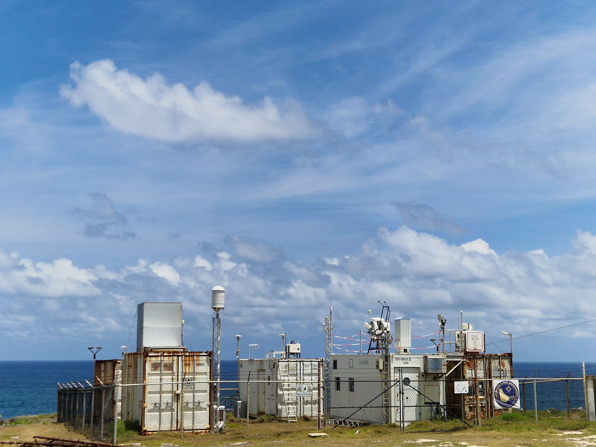

instruments measuring clouds, rain, radiation, surface meteorology...
:::

:::

:::{.column}
```{python}
fig1, ax1 = plt.subplots(
    figsize=(5, 5),
    subplot_kw={"projection": ccrs.Robinson()}
)

ax1.set_extent([-59.8, -59.3, 13.0, 13.4], crs=ccrs.PlateCarree())

ax1.add_feature(cfeature.LAND.with_scale("10m"),
                facecolor=LAND_COLOR, edgecolor=COAST_COLOR, linewidth=0.5, zorder=2)

ax1.plot(
    lon, lat,
    marker=".", markersize=20, color=ACCENT, markeredgecolor="white",
    markeredgewidth=0.8, transform=ccrs.PlateCarree(), zorder=5
)
ax1.text(
    lon + 0.01, lat + 0.01,
    f"Deebles Point,\nBarbados\n{lon:.2f}, {lat:.2f}",
    fontsize=10,
    family="Arial",
    color=COAST_COLOR,
    transform=ccrs.PlateCarree(),
    zorder=6,
    ha='left',
)
figg.patch.set_alpha(0)
plt.box(False)
```
:::
:::

# my job: make BCO datasets [^1]

:::{.fragment}
[^1]: continuously growing, analysis-ready, cloud-optimized datasets, which are versioned, reproducible, and quality controlled
:::

## weather and climate data wrangling

* individuals run painstaking processing for period(s) and instrument(s) of interest

. . .

 * or if the data is processed, it is probably (choose one or more):

:::{.fragment}
 * private to individuals or institutions
 * (down)loaded eagerly
 * not versioned, hashed, or content-addressable
:::

## (even / especially) large organizations are not perfect

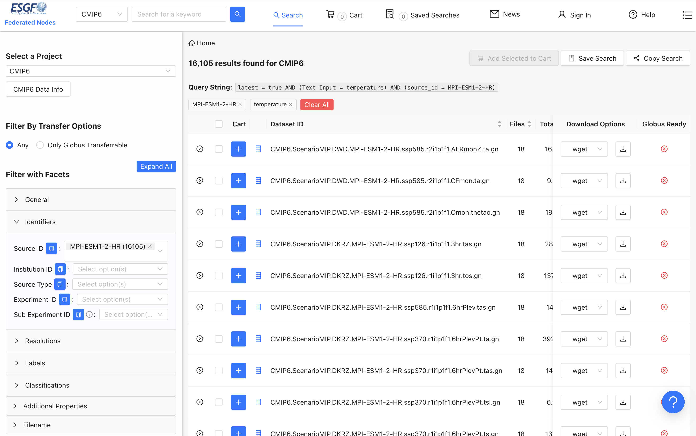

## downloads a shell script

```{python}
#| echo: true
with open("static/wget_script_2026-11-20_18-48-52.sh", 'r') as f:
        print(f"shell script is {sum(1 for line in f)} lines")
```

## all of this to download 18 netcdfs

```{bash}
download_files="$(cat <<EOF--dataset.file.url.chksum_type.chksum
'ta_AERmonZ_MPI-ESM1-2-HR_ssp585_r2i1p1f1_gn_201501-201912.nc' 'http://esgf3.dkrz.de/thredds/fileServer/cmip6/ScenarioMIP/DWD/MPI-ESM1-2-HR/ssp585/r2i1p1f1/AERmonZ/ta/gn/v20190710/ta_AERmonZ_MPI-ESM1-2-HR_ssp585_r2i1p1f1_gn_201501-201912.nc' 'SHA256' '8e44799f025076eca06db7ed7e811a54dba59fd8b6c9b436cca64a08ea9337fc'
'ta_AERmonZ_MPI-ESM1-2-HR_ssp585_r2i1p1f1_gn_202001-202412.nc' 'http://esgf3.dkrz.de/thredds/fileServer/cmip6/ScenarioMIP/DWD/MPI-ESM1-2-HR/ssp585/r2i1p1f1/AERmonZ/ta/gn/v20190710/ta_AERmonZ_MPI-ESM1-2-HR_ssp585_r2i1p1f1_gn_202001-202412.nc' 'SHA256' '29c416b8a940aba48212dffc461ecaca1408419eee29860d64bc3efea86d75b0'
'ta_AERmonZ_MPI-ESM1-2-HR_ssp585_r2i1p1f1_gn_202501-202912.nc' 'http://esgf3.dkrz.de/thredds/fileServer/cmip6/ScenarioMIP/DWD/MPI-ESM1-2-HR/ssp585/r2i1p1f1/AERmonZ/ta/gn/v20190710/ta_AERmonZ_MPI-ESM1-2-HR_ssp585_r2i1p1f1_gn_202501-202912.nc' 'SHA256' '8c8208aec60aacc91affce87a986f61a569dbdd110a61828d05a95ea832c38e2'
'ta_AERmonZ_MPI-ESM1-2-HR_ssp585_r2i1p1f1_gn_203001-203412.nc' 'http://esgf3.dkrz.de/thredds/fileServer/cmip6/ScenarioMIP/DWD/MPI-ESM1-2-HR/ssp585/r2i1p1f1/AERmonZ/ta/gn/v20190710/ta_AERmonZ_MPI-ESM1-2-HR_ssp585_r2i1p1f1_gn_203001-203412.nc' 'SHA256' '1c25d3005850a1bca7ea65e2b69a9273d6222683f6faf2e91f267b4dae483f85'
'ta_AERmonZ_MPI-ESM1-2-HR_ssp585_r2i1p1f1_gn_203501-203912.nc' 'http://esgf3.dkrz.de/thredds/fileServer/cmip6/ScenarioMIP/DWD/MPI-ESM1-2-HR/ssp585/r2i1p1f1/AERmonZ/ta/gn/v20190710/ta_AERmonZ_MPI-ESM1-2-HR_ssp585_r2i1p1f1_gn_203501-203912.nc' 'SHA256' '70e62190627b04b6c06d8c2cccc419d5816f8cfc5fb7a36c67faac46825b8fc1'
'ta_AERmonZ_MPI-ESM1-2-HR_ssp585_r2i1p1f1_gn_204001-204412.nc' 'http://esgf3.dkrz.de/thredds/fileServer/cmip6/ScenarioMIP/DWD/MPI-ESM1-2-HR/ssp585/r2i1p1f1/AERmonZ/ta/gn/v20190710/ta_AERmonZ_MPI-ESM1-2-HR_ssp585_r2i1p1f1_gn_204001-204412.nc' 'SHA256' 'dd51584cbbef310e75462b11e9346456fd616d5e668a8b7ff1f1aa5daa8802e5'
'ta_AERmonZ_MPI-ESM1-2-HR_ssp585_r2i1p1f1_gn_204501-204912.nc' 'http://esgf3.dkrz.de/thredds/fileServer/cmip6/ScenarioMIP/DWD/MPI-ESM1-2-HR/ssp585/r2i1p1f1/AERmonZ/ta/gn/v20190710/ta_AERmonZ_MPI-ESM1-2-HR_ssp585_r2i1p1f1_gn_204501-204912.nc' 'SHA256' '19ff152622b2f83e62b264d66bb35f638d4ab49be83477ef7633e5537bba6793'
'ta_AERmonZ_MPI-ESM1-2-HR_ssp585_r2i1p1f1_gn_205001-205412.nc' 'http://esgf3.dkrz.de/thredds/fileServer/cmip6/ScenarioMIP/DWD/MPI-ESM1-2-HR/ssp585/r2i1p1f1/AERmonZ/ta/gn/v20190710/ta_AERmonZ_MPI-ESM1-2-HR_ssp585_r2i1p1f1_gn_205001-205412.nc' 'SHA256' '20af86e46c848c1be03e5deafdf1309f07b7016381e4a9ecedfdbc8ce94df2ca'
'ta_AERmonZ_MPI-ESM1-2-HR_ssp585_r2i1p1f1_gn_205501-205912.nc' 'http://esgf3.dkrz.de/thredds/fileServer/cmip6/ScenarioMIP/DWD/MPI-ESM1-2-HR/ssp585/r2i1p1f1/AERmonZ/ta/gn/v20190710/ta_AERmonZ_MPI-ESM1-2-HR_ssp585_r2i1p1f1_gn_205501-205912.nc' 'SHA256' '835ab27a12d83464afd4fdd1528cfe800895006a2f2739da2c10b4985acf4ee1'
'ta_AERmonZ_MPI-ESM1-2-HR_ssp585_r2i1p1f1_gn_206001-206412.nc' 'http://esgf3.dkrz.de/thredds/fileServer/cmip6/ScenarioMIP/DWD/MPI-ESM1-2-HR/ssp585/r2i1p1f1/AERmonZ/ta/gn/v20190710/ta_AERmonZ_MPI-ESM1-2-HR_ssp585_r2i1p1f1_gn_206001-206412.nc' 'SHA256' '36535020a9e57d9f1b0a53045a9d424f841467b51f2b35004ae2e88c38886b8d'
'ta_AERmonZ_MPI-ESM1-2-HR_ssp585_r2i1p1f1_gn_206501-206912.nc' 'http://esgf3.dkrz.de/thredds/fileServer/cmip6/ScenarioMIP/DWD/MPI-ESM1-2-HR/ssp585/r2i1p1f1/AERmonZ/ta/gn/v20190710/ta_AERmonZ_MPI-ESM1-2-HR_ssp585_r2i1p1f1_gn_206501-206912.nc' 'SHA256' '15d7d05f398b14449404f6c5ef178b930af88c62f5a4c3826a427dd52b60e936'
'ta_AERmonZ_MPI-ESM1-2-HR_ssp585_r2i1p1f1_gn_207001-207412.nc' 'http://esgf3.dkrz.de/thredds/fileServer/cmip6/ScenarioMIP/DWD/MPI-ESM1-2-HR/ssp585/r2i1p1f1/AERmonZ/ta/gn/v20190710/ta_AERmonZ_MPI-ESM1-2-HR_ssp585_r2i1p1f1_gn_207001-207412.nc' 'SHA256' '507764dcda8233f5223b5c6dc09c577f2312b075559c89c5224e2d7bbf2772db'
'ta_AERmonZ_MPI-ESM1-2-HR_ssp585_r2i1p1f1_gn_207501-207912.nc' 'http://esgf3.dkrz.de/thredds/fileServer/cmip6/ScenarioMIP/DWD/MPI-ESM1-2-HR/ssp585/r2i1p1f1/AERmonZ/ta/gn/v20190710/ta_AERmonZ_MPI-ESM1-2-HR_ssp585_r2i1p1f1_gn_207501-207912.nc' 'SHA256' '3a2a1687ff071dec5ef960e9b28a65be584529b71f8756114f28485857fa8e18'
'ta_AERmonZ_MPI-ESM1-2-HR_ssp585_r2i1p1f1_gn_208001-208412.nc' 'http://esgf3.dkrz.de/thredds/fileServer/cmip6/ScenarioMIP/DWD/MPI-ESM1-2-HR/ssp585/r2i1p1f1/AERmonZ/ta/gn/v20190710/ta_AERmonZ_MPI-ESM1-2-HR_ssp585_r2i1p1f1_gn_208001-208412.nc' 'SHA256' '68beb694fc61be818b02772cf77299a67cf032132ab77d8cedd08688d0b88c74'
'ta_AERmonZ_MPI-ESM1-2-HR_ssp585_r2i1p1f1_gn_208501-208912.nc' 'http://esgf3.dkrz.de/thredds/fileServer/cmip6/ScenarioMIP/DWD/MPI-ESM1-2-HR/ssp585/r2i1p1f1/AERmonZ/ta/gn/v20190710/ta_AERmonZ_MPI-ESM1-2-HR_ssp585_r2i1p1f1_gn_208501-208912.nc' 'SHA256' '6cc038ad3a5c513209b28839eeb6fec1b5b402b261c51187470b7ab74161200c'
'ta_AERmonZ_MPI-ESM1-2-HR_ssp585_r2i1p1f1_gn_209001-209412.nc' 'http://esgf3.dkrz.de/thredds/fileServer/cmip6/ScenarioMIP/DWD/MPI-ESM1-2-HR/ssp585/r2i1p1f1/AERmonZ/ta/gn/v20190710/ta_AERmonZ_MPI-ESM1-2-HR_ssp585_r2i1p1f1_gn_209001-209412.nc' 'SHA256' '2ff05ee5e9c888125c931969d3214988e24671bd44493c222f40e1ac5c5a4cb2'
'ta_AERmonZ_MPI-ESM1-2-HR_ssp585_r2i1p1f1_gn_209501-209912.nc' 'http://esgf3.dkrz.de/thredds/fileServer/cmip6/ScenarioMIP/DWD/MPI-ESM1-2-HR/ssp585/r2i1p1f1/AERmonZ/ta/gn/v20190710/ta_AERmonZ_MPI-ESM1-2-HR_ssp585_r2i1p1f1_gn_209501-209912.nc' 'SHA256' '4835be984f99cabadac7539d35e350f81d658655d8d513ab421799caca81bac2'
'ta_AERmonZ_MPI-ESM1-2-HR_ssp585_r2i1p1f1_gn_210001-210012.nc' 'http://esgf3.dkrz.de/thredds/fileServer/cmip6/ScenarioMIP/DWD/MPI-ESM1-2-HR/ssp585/r2i1p1f1/AERmonZ/ta/gn/v20190710/ta_AERmonZ_MPI-ESM1-2-HR_ssp585_r2i1p1f1_gn_210001-210012.nc' 'SHA256' '15e2fa8c6ed13c4cad79a17186da66c06e23da886397a30a4c47119a405449fd'
EOF--dataset.file.url.chksum_type.chksum
)"
```

. . .

but at least they're checksummed

## our philosophy

 * analysis-ready, cloud-optimized (ARCO) datasets[^2]

:::{.fragment}
 * [zarr](https://zarr.dev/) format on a publicly available [object store](https://docs.dkrz.de/doc/datastorage/swift/index.html)
   * lazy loading

{height=52px fig-align='center'}
:::

:::{.fragment}
 * burden on provider, not user<span style="color: #CE3072;">s</span>
:::

:::{.fragment}
 * versioned and reproducible processing
:::


[^2]: R. P. Abernathey et al. (2021). [Cloud-Native Repositories for Big Scientific Data](https://doi.org/10.1109/MCSE.2021.3059437), Computing in Science & Engineering.

## particularity of continuously-growing datasets

(as opposed to campaign data, model data)

:::{.fragment}
```{python3}
xr.open_mfdataset([pd.read_csv(f).to_xarray() for f in rawfiles])
```
:::

:::{.fragment}
_is not well-suited to an ever-growing (and -changing) record_

```{sh}
ERROR: cannot reindex along dimension 'range' with differing sizes {'range': 200} and {'range': 199}
```
:::

## it isn't straightforward

```{python3}
xr.open_mfdataset("**/bco_radar_dataset_*.nc")
```
:::{.fragment}
_would fail due to the sheer number of files_
:::

:::{.fragment}
_not to mention other buggy oddities_

```{sh}
ERROR: non-monotonic time axis!
```
:::


## implementation

 * automated workflows using [Apache Airflow](https://airflow.apache.org)'s direct acyclic graphs (DAGs)

 * each dataset:
   * versioned with its processing code and that of its input datasets -> unique object ID
   * reproducible

## direct acyclic graphs (DAGs)

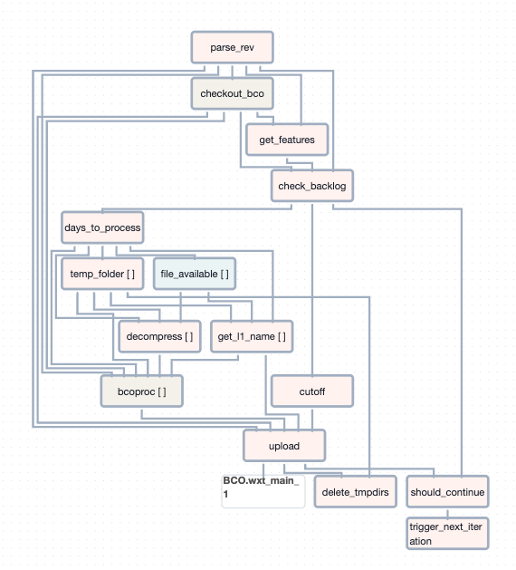

:::{.aside}
level 1 DAG, triggers downstream processing
::: 

## data hierarchy and products

:::{.fragment}
 * level 0 (raw)
:::

:::{.fragment}
 * level 1 (concatenated and cleaned)
:::

:::{.fragment}
 * level 2 (analysis-ready, controlled, time aggregations)
:::

:::{.fragment}
* level 3 (multi-sensor products)
:::

# datasets: a tasting menu

## data access

```{python}
#| echo: true
import intake
cat = intake.open_catalog("https://tcodata.mpimet.mpg.de/catalog.yaml")
print(len(list(cat.BCO)))
[e for e in list(cat.BCO) if "LIDAR" not in e and "lidar" not in e]
```

## surface meteorology


```{python}
axis_labels = {"fontsize": 18}
line_args = {"color": line_color, "linewidth": 2}
line_args_acc = {"color": ACCENT, "linewidth": 2}
```

```{python}
#| echo: true
sfc = cat.BCO.surfacemet(time="P1D").to_dask()
sfc.ta.plot(**line_args)
plt.title(None)
plt.ylabel("T / deg C", **axis_labels);
```

## surface meteorology {transition=none}

```{python}
#| echo: true
dir = np.mod(180 + np.degrees(np.arctan2(sfc.u, sfc.v)), 360)
dir.plot.hist(bins=75, density=True, color=line_color)
plt.title(None)
plt.xlabel("wind dir / deg", **axis_labels);
```

## rain

```{python}
from matplotlib.patches import Patch
son = [9, 10, 11]
jfm = [1, 2, 3]
wet_color = LAND_COLOR
dry_color = ACCENT
def get_season_blocks(time_arr, month_arr, target_months):
    mask = np.isin(month_arr, list(target_months))
    mask_padded = np.concatenate(([False], mask, [False]))
    idx_changes = np.where(mask_padded[:-1] != mask_padded[1:])[0]

    blocks = idx_changes.reshape(-1, 2)

    time_bounds = []
    for start, end in blocks:
        t_start = time_arr[start]
        t_end = time_arr[min(end, len(time_arr) - 1)]
        time_bounds.append((t_start, t_end))
    return time_bounds

fig5, ax5 = plt.subplots(figsize=(14, 2))
sfc.rain_intensity.rolling(time=7).mean().plot()

for start, end in get_season_blocks(sfc.time.values, sfc.time.dt.month, jfm):
    ax5.axvspan(start, end, color=dry_color, alpha=0.2, zorder=0)
for start, end in get_season_blocks(sfc.time.values, sfc.time.dt.month, son):
    ax5.axvspan(start, end, color=wet_color, alpha=0.2, zorder=0)

legend_elements = [
    Patch(facecolor=dry_color, alpha=0.5, label='JFM (dry)'),
    Patch(facecolor=wet_color, alpha=0.5, label='SON (wet)')
]
ax5.legend(handles=legend_elements, loc='upper left')
plt.title(None)
plt.xlabel("time", **axis_labels)
plt.ylabel("rolling rain / mm h-1");
```
## a short tour: cloud atlas

```{python}
#| echo: true
ds = cat.BCO.cloudradar(time="P1D").to_dask()
ds.cloud_fraction.sel(time=ds.time.dt.month.isin([1, 2, 3])).mean(dim="time").plot(y="alt", label="JFM", **line_args)
ds.cloud_fraction.sel(time=ds.time.dt.month.isin([9, 10, 11])).mean(dim="time").plot(y="alt", label="SON", **line_args_acc)
plt.title("Z > -40 dBZ", **axis_labels)
plt.ylabel("alt / m", **axis_labels)
plt.xlabel("cloud fraction / 1", **axis_labels)
plt.legend()
plt.show()
```

## cloud atlas

```{python}
Z = cat.BCO.cloudradar(time="raw").to_dask().Z.sel(alt=slice(None, 15000))
choice = np.datetime64("2025-02-22T00:30")
time_window = 35
start_time = choice - np.timedelta64(time_window, "m")
end_time = choice + np.timedelta64(time_window, "m")
```

```{python}
#| echo: true
clouds = Z.sel(time=slice(start_time, end_time))
clouds.plot(y="alt", robust=True, cmap="Greys", vmin=-60, vmax=35, cbar_kwargs={'label': 'Z / dBZ'}, extend="both")
plt.ylabel("alt / m", **axis_labels)
plt.xlabel("time", **axis_labels)
plt.title(None);
```

:::{.aside}
trade cumulus
:::

## a short tour: cloud atlas

```{python}
choice = np.datetime64("2024-10-13T11:30")
time_window = 35
start_time = choice - np.timedelta64(time_window, "m")
end_time = choice + np.timedelta64(time_window, "m")
```

```{python}
#| echo: true
clouds = Z.sel(time=slice(start_time, end_time))
clouds.plot(y="alt", robust=True, cmap="Greys", vmin=-60, vmax=35, cbar_kwargs={'label': 'Z / dBZ'}, extend="both")
plt.ylabel("alt / m", **axis_labels)
plt.xlabel("time", **axis_labels)
plt.title(None);
```

:::{.aside}
stratiform anvil
:::

## cloud atlas

```{python}
choice = np.datetime64("2026-10-11T10:45")
time_window = 45
start_time = choice - np.timedelta64(time_window, "m")
end_time = choice + np.timedelta64(time_window, "m")
```

```{python}
#| echo: true
clouds = Z.sel(time=slice(start_time, end_time))
clouds.plot(y="alt", robust=True, cmap="Greys", vmin=-60, vmax=35, cbar_kwargs={'label': 'Z / dBZ'}, extend="both")
plt.ylabel("alt / m", **axis_labels)
plt.xlabel("time", **axis_labels)
plt.title(None);
```

:::{.aside}
deep convection
:::

## cloud atlas

```{python}
choice = np.datetime64("2024-10-16T08:25")
time_window = 20
start_time = choice - np.timedelta64(time_window, "m")
end_time = choice + np.timedelta64(time_window, "m")
```

```{python}
#| echo: true
clouds = Z.sel(time=slice(start_time, end_time), alt=slice(None, 8000))
clouds.plot(y="alt", robust=True, cmap="Greys", vmin=-60, vmax=35, cbar_kwargs={'label': 'Z / dBZ'}, extend="both")
plt.ylabel("alt / m", **axis_labels)
plt.xlabel("time", **axis_labels)
plt.title(None);
```

:::{.aside}
congestus
:::

## cloud atlas

```{python}
choice = np.datetime64("2026-04-05T21:40")
time_window = 15
start_time = choice - np.timedelta64(time_window, "m")
end_time = choice + np.timedelta64(time_window, "m")
```

```{python}
#| echo: true
clouds = Z.sel(time=slice(start_time, end_time))
clouds.plot(y="alt", robust=True, cmap="Greys", vmin=-60, vmax=35, cbar_kwargs={'label': 'Z / dBZ'}, extend="both")
plt.ylabel("alt / m", **axis_labels)
plt.xlabel("time", **axis_labels)
plt.title(None);
```

:::{.aside}
precipitating cumulus, altocumulus castellanus, and cirrus
:::

## science at the MPI-M

[^3]


[^3]: Feynman, R. (1964). Seeking New Laws. Cornell University lecture.

# a brief investigation 🧐

## <span style="color: #CE3072;">missing</span>: 2024 winter

```{python}
import pandas as pd
import xarray as xr
def resampleyr(da):
    da = da.resample(time="10D").mean()
    return da.assign_coords(time=np.arange(da.sizes["time"]))

annual = xr.concat([resampleyr(da) for _, da in sfc.ta.where(sfc.time.dt.year != 2024, drop=True).groupby("time.year")], dim="year")
mean = annual.mean("year")
std = annual.std("year")
for y in np.unique(sfc.time.dt.year):
    kwargs = {"color": "gray", "alpha": 0.3} if y!=2024 else {"color": ACCENT, "label": "2024"}
    dxyr = sfc.sel(time=str(y)).resample(time="10D").mean()
    plt.plot(dxyr.time.dt.dayofyear, dxyr.ta, **kwargs)
x = np.arange(mean.size) * 10 + 1
plt.fill_between(x, mean - std, mean + std, color="gray", alpha=0.3, label="±1 σ")
plt.plot(x, mean, color="black", label="mean (excluding 2024)", alpha=0.5)
xcoord = pd.date_range("2024-03-01", "2024-12-01", freq="3MS")
plt.xticks(xcoord.dayofyear, xcoord.strftime("%b"))
plt.ylabel("T / deg C", **axis_labels)
plt.xlabel("time", **axis_labels)
plt.legend();
```

## <span style="color: #CE3072;">missing</span> high clouds: a big-picture perspective

## {background-image="static/clouds.svg" background-size="contain"}

## a focused perspective

```{python}
high = lambda da: da.sel(alt=slice(8000, 15000))
low = lambda da: da.sel(alt=slice(None, 4000))
cloudclim = ds.cloud_fraction.groupby(ds.time.dt.month).mean()
anomaly = ds.cloud_fraction.groupby(ds.time.dt.month) - cloudclim
highanomaly = anomaly.pipe(high).compute()
lownaomaly = anomaly.pipe(low).compute()
months = ["2023-12", "2024-01", "2024-02", "2024-03"]

fig, (ax_h, ax_l) = plt.subplots(2, 2, figsize=(6, 6), constrained_layout=True, sharey="row")
axh_abs, axh_ano = ax_h
axl_abs, axl_ano = ax_l

for tsel in months:
    ds.cloud_fraction.pipe(high).sel(time=tsel).mean(dim="time").plot(y="alt", label=tsel, ax=axh_abs)
    ds.cloud_fraction.pipe(low).sel(time=tsel).mean(dim="time").plot(y="alt", label=tsel, ax=axl_abs)
    highanomaly.sel(time=tsel).mean(dim="time").plot(y="alt", label=tsel, ax=axh_ano)
    lownaomaly.sel(time=tsel).mean(dim="time").plot(y="alt", label=tsel, ax=axl_ano)

plt.setp(ax_h, ylabel="alt / m", xlabel="cloud fraction / 1")
axh_ano.set_ylabel(None)
plt.setp(ax_l, ylabel="alt / m", xlabel="cloud fraction / 1")
axl_ano.set_ylabel(None)
axh_abs.set_title("absolute")
axh_ano.set_title("absolute minus monthly climate")
plt.setp([axl_abs, axl_ano], title=None)
fig.legend(*axh_abs.get_legend_handles_labels(), bbox_to_anchor=(1., 0.0), ncol=len(months))

plt.show()
```

## trough in subtropical westerly jet

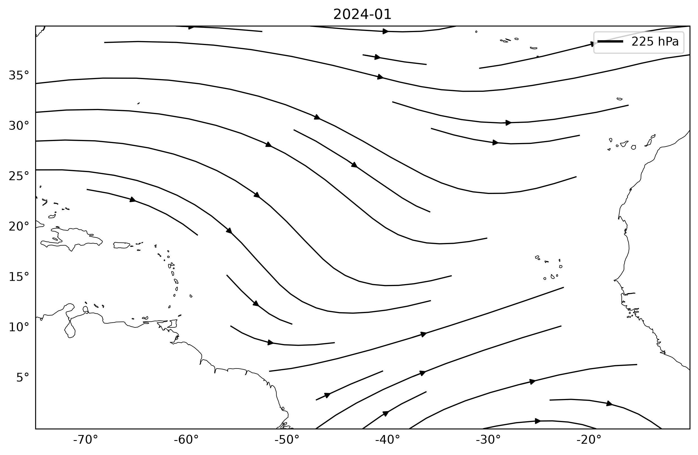

## proposed mechanism:

 * warm SSTs & upper-level subsidence
 * dry upper levels (chicken or egg?)
 * warm air cannot entrain as much (?)

:::{.fragment}

 * next: [^4]
    * moisture advection and relative humidity (in temperature space)
    * what else drives cirrus cloud amount at the BCO?
    * conversely, would a low convergence or a divergence anomaly (shallow trough, weaker jet) increase high cloud amount?

:::


[^4]: input welcomed!

# measurement campaign! 🚢

## San Diego (Dec 11) to Fiji (Jan 4)

```{python}
from matplotlib.patches import Rectangle
def coords_json_to_ds(path):
    import json
    with open(path, 'r') as f:
        data = json.load(f)
    
    coordinates = []
    for feature in data['features']:
        if feature['geometry']['type'] == 'Point':
            lon, lat, _alt = feature['geometry']['coordinates']
            coordinates.append([lat, lon])
    
    coords_array = np.array(coordinates)
    
    ds = xr.Dataset(
        coords={
            'lat': (('waypoint', coords_array[:, 0], {
                    "long_name": "north latitude",
                    "units": "degree_north",
                    "valid_min": -90.0,
                    "valid_max": 90.0,
                },)),
            'lon': (('waypoint', coords_array[:, 1], {
                    "long_name": "east longitude",
                    "units": "degree_east",
                    "valid_min": -180.0,
                    "valid_max": 180.0,
                },))
        }
    )
    
    return ds
def rename_and_sel(ds, vars):
    ds = ds.rename({"valid_time": "time", "latitude": "lat", "longitude": "lon"})[vars]
    return (ds.assign_coords(lon=(((ds.lon + 180) % 360) - 180))
            .sortby(["lon", "lat"])
            .sel(time=slice("1980", None),))
sst = xr.open_dataset(
    "https://data.earthdatahub.destine.eu/era5/era5-single-levels-atmosphere-monthly-v0.zarr",
    storage_options={"client_kwargs": {"trust_env": True}}, chunks={}, engine="zarr",
).pipe(rename_and_sel, ["sst"])
clim = sst.sst.groupby(sst.time.dt.month).mean()
fig, ax = plt.subplots(figsize=(12, 4), subplot_kw={'projection': ccrs.PlateCarree(central_longitude=180)})
anomaly = (sst.sst.groupby(sst.time.dt.month) - clim)
ax.add_feature(cfeature.COASTLINE)
route = coords_json_to_ds("static/journey.json")
ax.plot(route.lon, route.lat, 'o', transform=ccrs.PlateCarree(), color='black')
dx = anomaly.sel(time="1997-12").mean(dim="time")
im = ax.pcolormesh(
    dx.lon.values,
    dx.lat.values,
    dx,
    transform=ccrs.PlateCarree(),
    cmap="bwr",
    shading="auto",
    vmin=-3, vmax=5,
)
ax.add_patch(
    Rectangle(
        (170, -5),
        50,
        10,
        transform=ccrs.PlateCarree(),
        fill=False,
        edgecolor="k",
        lw=2,
    )
)
ax.set_extent([145, -100, -25, 25])
plt.title("Dec 1997 anomaly, Niño 3.4, and campaign route")
fig.colorbar(im, ax=ax, label="SST anomaly / deg K", extend='both')
plt.show()
```

## current anomaly

```{python}
fig, ax = plt.subplots(figsize=(12, 4), subplot_kw={'projection': ccrs.PlateCarree(central_longitude=180)})
anomaly = (sst.sst.groupby(sst.time.dt.month) - clim)
ax.add_feature(cfeature.COASTLINE)
ax.plot(route.lon, route.lat, 'o', transform=ccrs.PlateCarree(), color='black')
dx = anomaly.sel(time="2026-10").mean(dim="time")
im = ax.pcolormesh(
    dx.lon.values,
    dx.lat.values,
    dx,
    transform=ccrs.PlateCarree(),
    cmap="bwr",
    shading="auto",
    vmin=-3, vmax=5,
)
ax.add_patch(
    Rectangle(
        (170, -5),
        50,
        10,
        transform=ccrs.PlateCarree(),
        fill=False,
        edgecolor="k",
        lw=2,
    )
)
ax.set_extent([145, -100, -25, 25])
plt.title("Oct 2026 anomaly, Niño 3.4, and campaign route")
fig.colorbar(im, ax=ax, label="SST anomaly / deg K", extend='both')
plt.show()
```

## instrumentation

:::{.columns}


:::{.fragment}

:::{.column}


:::

:::

:::{.fragment}

:::{.column}

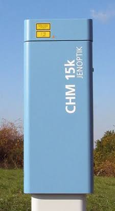

:::

:::

:::{.fragment}

:::{.column}

sea snake, all-sky camera, sun photometer

:::

:::

:::

## scientific scope

El Niño

# Thanks!

## P.S.

 * [TCO data](https://tcodata.mpimet.mpg.de), [ORCESTRA data](https://browser.orcestra-campaign.org/), [model data](https://easy.gems.dkrz.de/)
 * curious about:
   * p3 and the model!
   * run the bubble with CliMA?
   * AI, ML?
   * model output formats and storage?
   * strong scaling vs ICON?
   * convection (parameterization)?

## extra: trough in subtropical westerly jet

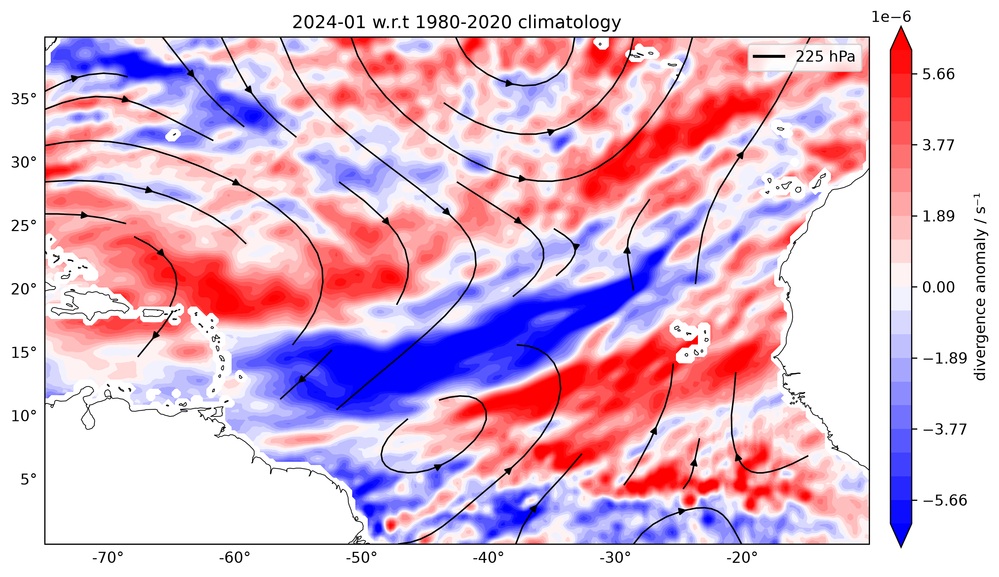

## extra: DJFM means

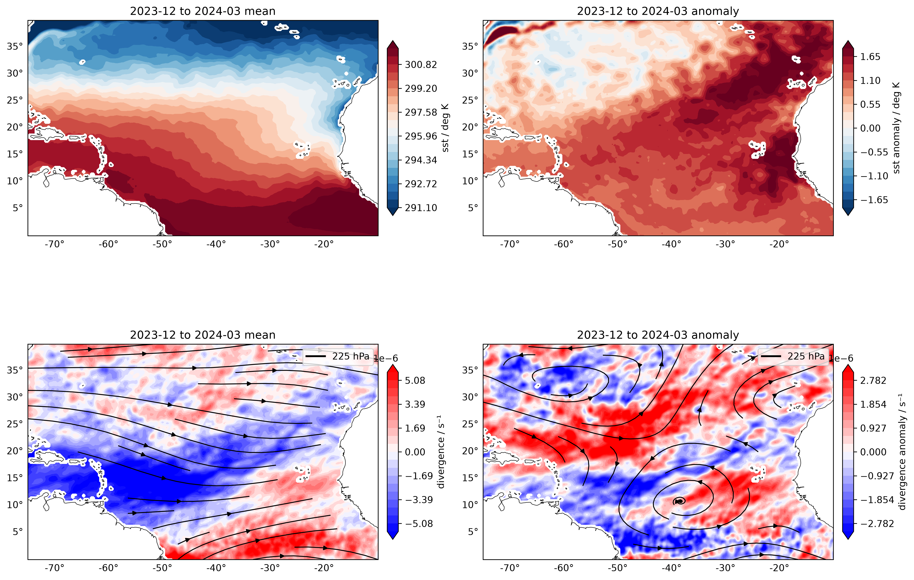

## extra: monthly means

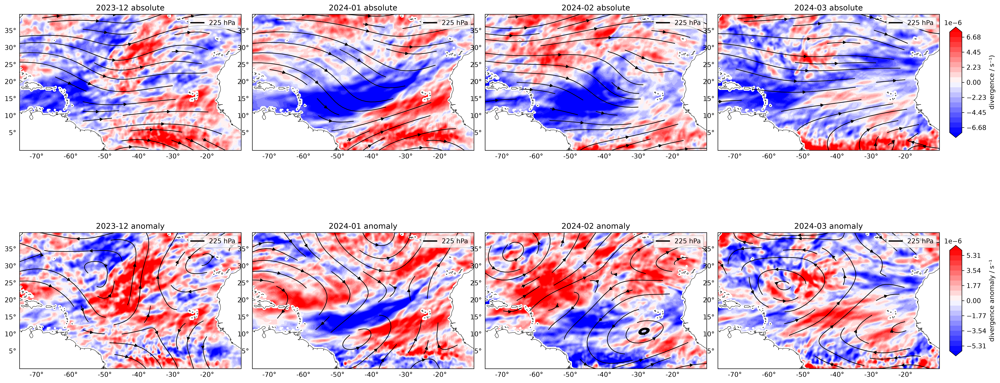

## extra: rh (in pressure space)

:::{.columns}

:::{.column}
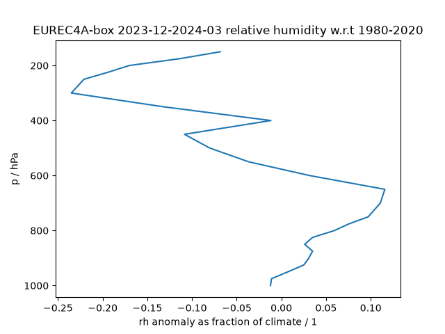
:::

:::{.column}
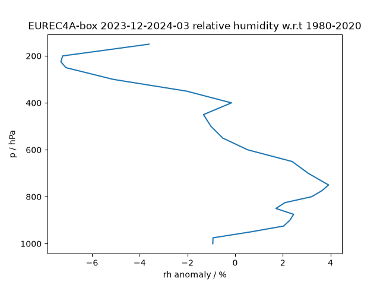
:::

:::

## extra: rh (in pressure space)

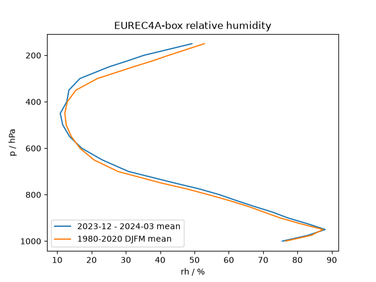

## extra: ta

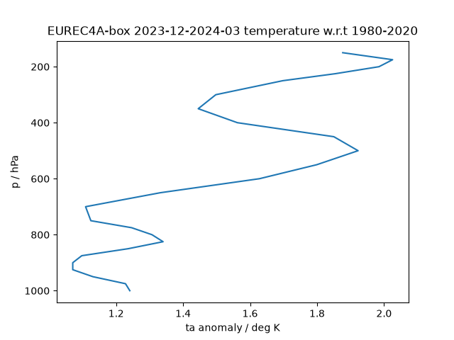

## science in practice:

* campaigns: [EUREC4A](https://eurec4a.eu/), [ORCESTRA](https://orcestra-campaign.org/)
* model experiments with a convection-permitting model:
  * aqua planets
  * global north and south
  * remove Americas
  * smoothed orography
  * LAMs

## extra: observations to test WTG?

```{python}
lidar = cat.BCO.lidar_CORAL_LR_t_c1_v1.to_dask().sel(time=slice("2020-01-01T14:00", "2020-01-01T14:06"), alt=slice(7500, 15000))
tcolor = plt.get_cmap("plasma")(np.linspace(0, 1, len(lidar.time)))
```

```{python}
#| echo: true
for i, t in enumerate(lidar.time.values):
    lidar.sel(time=t).ta.where(lambda da: (da > 0) & (da < 500)).plot(y="alt", label=t.astype("datetime64[m]"), color=tcolor[i])
plt.ylabel("alt / m", **axis_labels)
plt.xlabel("ta / deg K", **axis_labels)
plt.title(None)
plt.legend()
plt.show()
```
