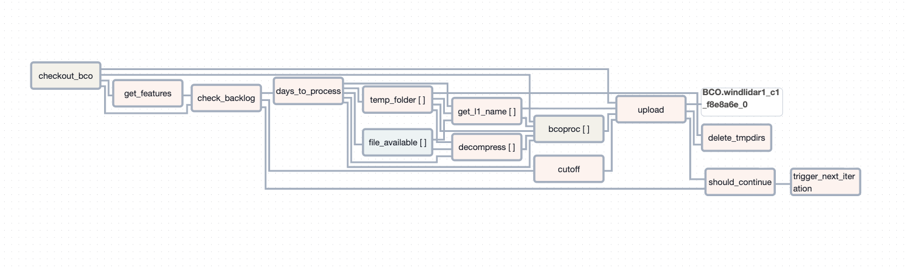
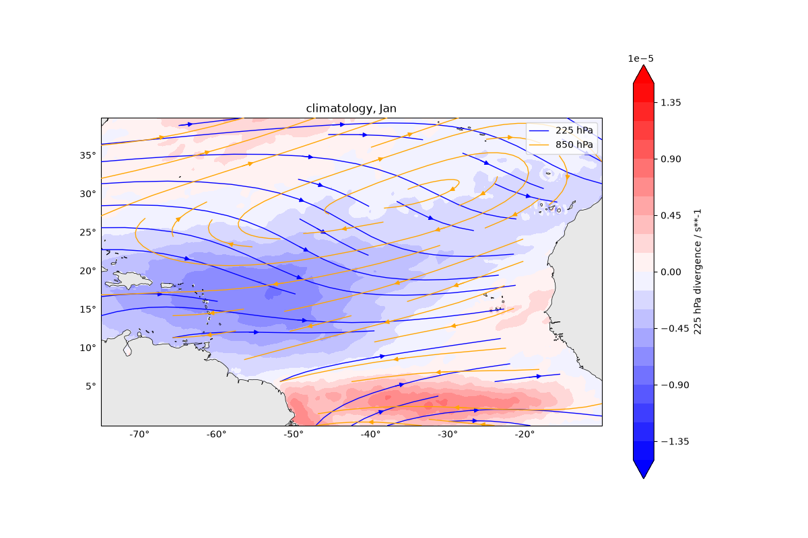
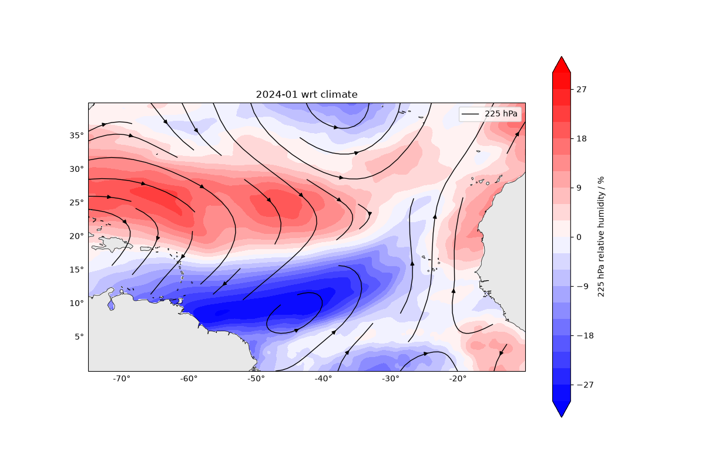

## Outline

* What I do (and why)
* What I'd like to do next (and why)

## as a guest, it's important to me to (at least try to) speak the language

## but here, it's English...






## outline

* What I did at CliMA: include a couple plots, thank Anna, Emily, Sajad, etc. say what I learned

# The Barbados Cloud Observatory (BCO)

## interest in the tropics

::::{.columns}
:::{.column}
* the tropics drive Earth's energetics and large scale circulations
:::

:::{.column}
```{python}
#| code-fold: true
#| code-summary: "expand"
import cartopy.crs as ccrs
import cartopy.feature as cfeature
import numpy as np
import matplotlib.pyplot as plt
LAND_COLOR = "#8ac3c3" # MPG green dark 40%
line_color = LAND_COLOR
COAST_COLOR   = "#555555" # gray
ACCENT = "#ffab57" # MPG orange 60%
figg, axg = plt.subplots(figsize=(7, 7), subplot_kw={"projection": ccrs.Orthographic(central_longitude=-20, central_latitude=10), })
axg.add_feature(cfeature.LAND, facecolor='lightgray', linewidth=0.5)
axg.add_feature(cfeature.OCEAN, facecolor='None')
axg.add_feature(cfeature.COASTLINE, linewidth=0.5, color=COAST_COLOR)
LON, LAT = np.meshgrid(np.linspace(-180, 180, 360), np.linspace(-90, 90, 180))
Z = np.zeros_like(LON)
Z[(LAT >= -30) & (LAT <= 30)] = 1
axg.set_global()
axg.contourf(LON, LAT, Z, levels=[0.5, 1.5], colors=[LAND_COLOR], 
             transform=ccrs.PlateCarree(), alpha=0.7)
figg.patch.set_alpha(0)
plt.show()
```
:::

::::


## let's go to the Atlantic {transition="none"}

::::{.columns}
:::{.column}
* understanding tropical circulation and energy means understanding tropical clouds, and vice versa
:::

:::{.column}
:::{.fragment}
```{python}
#| code-fold: true
#| code-summary: "expand"
lon = -59.4288
lat = 13.1627
def plot_extent_box(ax, extent, color="m", linewidth=2, transform=ccrs.PlateCarree()):
    return ax.add_patch(
        plt.Rectangle(
            xy=[extent[0], extent[2]],
            width=extent[1] - extent[0],
            height=extent[3] - extent[2],
            facecolor=color,
            edgecolor=color,
            linewidth=linewidth,
            transform=ccrs.PlateCarree(),
            alpha=0.25,
        )
    )
fig2, ax2 = plt.subplots(
    figsize=(8, 8),
    subplot_kw={"projection": ccrs.Robinson()}
)
ax2.set_extent([-70, 15, 0, 20], crs=ccrs.PlateCarree())
ax2.add_feature(cfeature.LAND.with_scale("50m"),
                facecolor=LAND_COLOR, edgecolor=COAST_COLOR, linewidth=0.5, zorder=2)
ax2.add_feature(cfeature.COASTLINE.with_scale("50m"),
                edgecolor=COAST_COLOR, linewidth=0.5, zorder=3)
```
:::
:::

::::

## clouds over the Atlantic {transition="none"}

::::{.columns}
:::{.column}
* understanding tropical circulation and energy means understanding tropical clouds, and vice versa
:::

:::{.column}
```{python}
fig2, ax2 = plt.subplots(
    figsize=(8, 8),
    subplot_kw={"projection": ccrs.Robinson()}
)
ax2.set_extent([-70, 15, 0, 20], crs=ccrs.PlateCarree())
ax2.add_feature(cfeature.LAND.with_scale("50m"),
                facecolor=LAND_COLOR, edgecolor=COAST_COLOR, linewidth=0.5, zorder=2)
ax2.add_feature(cfeature.COASTLINE.with_scale("50m"),
                edgecolor=COAST_COLOR, linewidth=0.5, zorder=3)
```
:::

::::
## clouds over the Atlantic {transition="none"}

::::{.columns}
:::{.column}
* understanding tropical circulation and energy means understanding tropical clouds, and vice versa
:::

:::{.column}
```{python}
fig2, ax2 = plt.subplots(
    figsize=(8, 8),
    subplot_kw={"projection": ccrs.Robinson()}
)
ax2.set_extent([-70, 15, 0, 20], crs=ccrs.PlateCarree())
ax2.add_feature(cfeature.LAND.with_scale("50m"),
                facecolor=LAND_COLOR, edgecolor=COAST_COLOR, linewidth=0.5, zorder=2)
ax2.add_feature(cfeature.COASTLINE.with_scale("50m"),
                edgecolor=COAST_COLOR, linewidth=0.5, zorder=3)
arrows = [
    (-55, 18), (-40, 18),
    (-50, 12), (-35, 12),
    (-45, 6),(-30, 6),
]
for arrow_lon, arrow_lat in arrows:
    ax2.annotate('', xy=(arrow_lon - 5, arrow_lat - 1), xytext=(arrow_lon + 5, arrow_lat + 1),
                xycoords=ccrs.PlateCarree()._as_mpl_transform(ax2),
                textcoords=ccrs.PlateCarree()._as_mpl_transform(ax2),
                arrowprops=dict(arrowstyle='->', color=COAST_COLOR, lw=1.5, alpha=0.7))
```
:::

::::
## clouds over the Atlantic {transition="none" auto-animate=true}

::::{.columns}
:::{.column}
* understanding tropical circulation and energy means understanding tropical clouds, and vice versa
:::

:::{.column}
```{python}
fig2, ax2 = plt.subplots(
    figsize=(8, 8),
    subplot_kw={"projection": ccrs.Robinson()}
)
ax2.set_extent([-70, 15, 0, 20], crs=ccrs.PlateCarree())
ax2.add_feature(cfeature.LAND.with_scale("50m"),
                facecolor=LAND_COLOR, edgecolor=COAST_COLOR, linewidth=0.5, zorder=2)
ax2.add_feature(cfeature.COASTLINE.with_scale("50m"),
                edgecolor=COAST_COLOR, linewidth=0.5, zorder=3)
arrows = [
    (-55, 18), (-40, 18),
    (-50, 12), (-35, 12),
    (-45, 6),(-30, 6),
]
for arrow_lon, arrow_lat in arrows:
    ax2.annotate('', xy=(arrow_lon - 5, arrow_lat - 1), xytext=(arrow_lon + 5, arrow_lat + 1),
                xycoords=ccrs.PlateCarree()._as_mpl_transform(ax2),
                textcoords=ccrs.PlateCarree()._as_mpl_transform(ax2),
                arrowprops=dict(arrowstyle='->', color=COAST_COLOR, lw=1.5, alpha=0.7))

ax2.plot(
    lon, lat,
    marker=".", markersize=12, color=ACCENT, markeredgecolor="white",
    markeredgewidth=0.8, transform=ccrs.PlateCarree(), zorder=5
)
plot_extent_box(ax2, extent=[-58.5, -57, 12.5, 14], color=ACCENT)
```
:::{.fragment}
<span style="color: #ffab57"> BCO, and '[EUREC4A](https://eurec4a.eu/) box'</span>
:::
:::

::::


## <span style="color: #ffab57">Half a climate</span> at the [BCO](https://tcodata.mpimet.mpg.de)


:::{.columns}

:::{.column}

:::{.fragment}
est. Dec 2010
:::

:::{.fragment}

:::

:::

:::{.column}
```{python}
fig1, ax1 = plt.subplots(
    figsize=(5, 5),
    subplot_kw={"projection": ccrs.Robinson()}
)

ax1.set_extent([-59.8, -59.3, 13.0, 13.4], crs=ccrs.PlateCarree())

ax1.add_feature(cfeature.LAND.with_scale("10m"),
                facecolor=LAND_COLOR, edgecolor=COAST_COLOR, linewidth=0.5, zorder=2)

ax1.plot(
    lon, lat,
    marker=".", markersize=20, color=ACCENT, markeredgecolor="white",
    markeredgewidth=0.8, transform=ccrs.PlateCarree(), zorder=5
)
ax1.text(
    lon + 0.01, lat + 0.01,
    f"Deebles Point,\nBarbados\n{lon:.2f}, {lat:.2f}",
    fontsize=10,
    family="Arial",
    color=COAST_COLOR,
    transform=ccrs.PlateCarree(),
    zorder=6,
    ha='left',
)
figg.patch.set_alpha(0)
plt.box(False)
```
:::
:::

# my job: make datasets [^1]

:::{.fragment}
[^1]: continuously growing, analysis-ready, cloud-optimized datasets, which are versioned, reproducible, and quality controlled
:::

## observational data is messy

```{python3}
xr.open_mfdataset("**/bco_radar_dataset_*.nc")
```
:::{.fragment}
_would fail due to the sheer number of files_
:::

:::{.fragment}
```{python3}
xr.open_mfdataset([pd.read_csv(f).to_xarray() for f in rawfiles])
```
:::

:::{.fragment}
_is not well-suited to an ever-growing (and -changing) record_

```{sh}
ERROR: cannot reindex along dimension 'range' with differing sizes {'range': 200} and {'range': 199}
```
:::

:::{.fragment}
_not to mention other buggy oddities_

```{sh}
ERROR: non-monotonic time axis!
```
:::

## previously, on _climate data diving_

* individuals run painstaking processing for period(s) and instrument(s) of interest

. . .

* or if the data is processed, it is probably (choose one or more):

:::{.fragment}
  * private to individuals or institutions
  * (down)loaded eagerly
  * not versioned, hashed, or content-addressable
:::

## even model data can be ugly


## downloads a shell script

```{python}
#| echo: true
with open("static/wget_script_2026-11-20_18-48-52.sh", 'r') as f:
        print(sum(1 for line in f))
```

## which in turn downloads these netcdfs

```{bash}
download_files="$(cat <<EOF--dataset.file.url.chksum_type.chksum
'ta_AERmonZ_MPI-ESM1-2-HR_ssp585_r2i1p1f1_gn_201501-201912.nc' 'http://esgf3.dkrz.de/thredds/fileServer/cmip6/ScenarioMIP/DWD/MPI-ESM1-2-HR/ssp585/r2i1p1f1/AERmonZ/ta/gn/v20190710/ta_AERmonZ_MPI-ESM1-2-HR_ssp585_r2i1p1f1_gn_201501-201912.nc' 'SHA256' '8e44799f025076eca06db7ed7e811a54dba59fd8b6c9b436cca64a08ea9337fc'
'ta_AERmonZ_MPI-ESM1-2-HR_ssp585_r2i1p1f1_gn_202001-202412.nc' 'http://esgf3.dkrz.de/thredds/fileServer/cmip6/ScenarioMIP/DWD/MPI-ESM1-2-HR/ssp585/r2i1p1f1/AERmonZ/ta/gn/v20190710/ta_AERmonZ_MPI-ESM1-2-HR_ssp585_r2i1p1f1_gn_202001-202412.nc' 'SHA256' '29c416b8a940aba48212dffc461ecaca1408419eee29860d64bc3efea86d75b0'
'ta_AERmonZ_MPI-ESM1-2-HR_ssp585_r2i1p1f1_gn_202501-202912.nc' 'http://esgf3.dkrz.de/thredds/fileServer/cmip6/ScenarioMIP/DWD/MPI-ESM1-2-HR/ssp585/r2i1p1f1/AERmonZ/ta/gn/v20190710/ta_AERmonZ_MPI-ESM1-2-HR_ssp585_r2i1p1f1_gn_202501-202912.nc' 'SHA256' '8c8208aec60aacc91affce87a986f61a569dbdd110a61828d05a95ea832c38e2'
'ta_AERmonZ_MPI-ESM1-2-HR_ssp585_r2i1p1f1_gn_203001-203412.nc' 'http://esgf3.dkrz.de/thredds/fileServer/cmip6/ScenarioMIP/DWD/MPI-ESM1-2-HR/ssp585/r2i1p1f1/AERmonZ/ta/gn/v20190710/ta_AERmonZ_MPI-ESM1-2-HR_ssp585_r2i1p1f1_gn_203001-203412.nc' 'SHA256' '1c25d3005850a1bca7ea65e2b69a9273d6222683f6faf2e91f267b4dae483f85'
'ta_AERmonZ_MPI-ESM1-2-HR_ssp585_r2i1p1f1_gn_203501-203912.nc' 'http://esgf3.dkrz.de/thredds/fileServer/cmip6/ScenarioMIP/DWD/MPI-ESM1-2-HR/ssp585/r2i1p1f1/AERmonZ/ta/gn/v20190710/ta_AERmonZ_MPI-ESM1-2-HR_ssp585_r2i1p1f1_gn_203501-203912.nc' 'SHA256' '70e62190627b04b6c06d8c2cccc419d5816f8cfc5fb7a36c67faac46825b8fc1'
'ta_AERmonZ_MPI-ESM1-2-HR_ssp585_r2i1p1f1_gn_204001-204412.nc' 'http://esgf3.dkrz.de/thredds/fileServer/cmip6/ScenarioMIP/DWD/MPI-ESM1-2-HR/ssp585/r2i1p1f1/AERmonZ/ta/gn/v20190710/ta_AERmonZ_MPI-ESM1-2-HR_ssp585_r2i1p1f1_gn_204001-204412.nc' 'SHA256' 'dd51584cbbef310e75462b11e9346456fd616d5e668a8b7ff1f1aa5daa8802e5'
'ta_AERmonZ_MPI-ESM1-2-HR_ssp585_r2i1p1f1_gn_204501-204912.nc' 'http://esgf3.dkrz.de/thredds/fileServer/cmip6/ScenarioMIP/DWD/MPI-ESM1-2-HR/ssp585/r2i1p1f1/AERmonZ/ta/gn/v20190710/ta_AERmonZ_MPI-ESM1-2-HR_ssp585_r2i1p1f1_gn_204501-204912.nc' 'SHA256' '19ff152622b2f83e62b264d66bb35f638d4ab49be83477ef7633e5537bba6793'
'ta_AERmonZ_MPI-ESM1-2-HR_ssp585_r2i1p1f1_gn_205001-205412.nc' 'http://esgf3.dkrz.de/thredds/fileServer/cmip6/ScenarioMIP/DWD/MPI-ESM1-2-HR/ssp585/r2i1p1f1/AERmonZ/ta/gn/v20190710/ta_AERmonZ_MPI-ESM1-2-HR_ssp585_r2i1p1f1_gn_205001-205412.nc' 'SHA256' '20af86e46c848c1be03e5deafdf1309f07b7016381e4a9ecedfdbc8ce94df2ca'
'ta_AERmonZ_MPI-ESM1-2-HR_ssp585_r2i1p1f1_gn_205501-205912.nc' 'http://esgf3.dkrz.de/thredds/fileServer/cmip6/ScenarioMIP/DWD/MPI-ESM1-2-HR/ssp585/r2i1p1f1/AERmonZ/ta/gn/v20190710/ta_AERmonZ_MPI-ESM1-2-HR_ssp585_r2i1p1f1_gn_205501-205912.nc' 'SHA256' '835ab27a12d83464afd4fdd1528cfe800895006a2f2739da2c10b4985acf4ee1'
'ta_AERmonZ_MPI-ESM1-2-HR_ssp585_r2i1p1f1_gn_206001-206412.nc' 'http://esgf3.dkrz.de/thredds/fileServer/cmip6/ScenarioMIP/DWD/MPI-ESM1-2-HR/ssp585/r2i1p1f1/AERmonZ/ta/gn/v20190710/ta_AERmonZ_MPI-ESM1-2-HR_ssp585_r2i1p1f1_gn_206001-206412.nc' 'SHA256' '36535020a9e57d9f1b0a53045a9d424f841467b51f2b35004ae2e88c38886b8d'
'ta_AERmonZ_MPI-ESM1-2-HR_ssp585_r2i1p1f1_gn_206501-206912.nc' 'http://esgf3.dkrz.de/thredds/fileServer/cmip6/ScenarioMIP/DWD/MPI-ESM1-2-HR/ssp585/r2i1p1f1/AERmonZ/ta/gn/v20190710/ta_AERmonZ_MPI-ESM1-2-HR_ssp585_r2i1p1f1_gn_206501-206912.nc' 'SHA256' '15d7d05f398b14449404f6c5ef178b930af88c62f5a4c3826a427dd52b60e936'
'ta_AERmonZ_MPI-ESM1-2-HR_ssp585_r2i1p1f1_gn_207001-207412.nc' 'http://esgf3.dkrz.de/thredds/fileServer/cmip6/ScenarioMIP/DWD/MPI-ESM1-2-HR/ssp585/r2i1p1f1/AERmonZ/ta/gn/v20190710/ta_AERmonZ_MPI-ESM1-2-HR_ssp585_r2i1p1f1_gn_207001-207412.nc' 'SHA256' '507764dcda8233f5223b5c6dc09c577f2312b075559c89c5224e2d7bbf2772db'
'ta_AERmonZ_MPI-ESM1-2-HR_ssp585_r2i1p1f1_gn_207501-207912.nc' 'http://esgf3.dkrz.de/thredds/fileServer/cmip6/ScenarioMIP/DWD/MPI-ESM1-2-HR/ssp585/r2i1p1f1/AERmonZ/ta/gn/v20190710/ta_AERmonZ_MPI-ESM1-2-HR_ssp585_r2i1p1f1_gn_207501-207912.nc' 'SHA256' '3a2a1687ff071dec5ef960e9b28a65be584529b71f8756114f28485857fa8e18'
'ta_AERmonZ_MPI-ESM1-2-HR_ssp585_r2i1p1f1_gn_208001-208412.nc' 'http://esgf3.dkrz.de/thredds/fileServer/cmip6/ScenarioMIP/DWD/MPI-ESM1-2-HR/ssp585/r2i1p1f1/AERmonZ/ta/gn/v20190710/ta_AERmonZ_MPI-ESM1-2-HR_ssp585_r2i1p1f1_gn_208001-208412.nc' 'SHA256' '68beb694fc61be818b02772cf77299a67cf032132ab77d8cedd08688d0b88c74'
'ta_AERmonZ_MPI-ESM1-2-HR_ssp585_r2i1p1f1_gn_208501-208912.nc' 'http://esgf3.dkrz.de/thredds/fileServer/cmip6/ScenarioMIP/DWD/MPI-ESM1-2-HR/ssp585/r2i1p1f1/AERmonZ/ta/gn/v20190710/ta_AERmonZ_MPI-ESM1-2-HR_ssp585_r2i1p1f1_gn_208501-208912.nc' 'SHA256' '6cc038ad3a5c513209b28839eeb6fec1b5b402b261c51187470b7ab74161200c'
'ta_AERmonZ_MPI-ESM1-2-HR_ssp585_r2i1p1f1_gn_209001-209412.nc' 'http://esgf3.dkrz.de/thredds/fileServer/cmip6/ScenarioMIP/DWD/MPI-ESM1-2-HR/ssp585/r2i1p1f1/AERmonZ/ta/gn/v20190710/ta_AERmonZ_MPI-ESM1-2-HR_ssp585_r2i1p1f1_gn_209001-209412.nc' 'SHA256' '2ff05ee5e9c888125c931969d3214988e24671bd44493c222f40e1ac5c5a4cb2'
'ta_AERmonZ_MPI-ESM1-2-HR_ssp585_r2i1p1f1_gn_209501-209912.nc' 'http://esgf3.dkrz.de/thredds/fileServer/cmip6/ScenarioMIP/DWD/MPI-ESM1-2-HR/ssp585/r2i1p1f1/AERmonZ/ta/gn/v20190710/ta_AERmonZ_MPI-ESM1-2-HR_ssp585_r2i1p1f1_gn_209501-209912.nc' 'SHA256' '4835be984f99cabadac7539d35e350f81d658655d8d513ab421799caca81bac2'
'ta_AERmonZ_MPI-ESM1-2-HR_ssp585_r2i1p1f1_gn_210001-210012.nc' 'http://esgf3.dkrz.de/thredds/fileServer/cmip6/ScenarioMIP/DWD/MPI-ESM1-2-HR/ssp585/r2i1p1f1/AERmonZ/ta/gn/v20190710/ta_AERmonZ_MPI-ESM1-2-HR_ssp585_r2i1p1f1_gn_210001-210012.nc' 'SHA256' '15e2fa8c6ed13c4cad79a17186da66c06e23da886397a30a4c47119a405449fd'
EOF--dataset.file.url.chksum_type.chksum
)"
```

. . .

but at least they're checksummed

## the solution

* analysis-ready, cloud-optimized (ARCO) datasets[^2]

:::{.fragment}
* [zarr](https://zarr.dev/) format on a publicly available [object store](https://docs.dkrz.de/doc/datastorage/swift/index.html)
    * lazy loading

{height=52px fig-align='center'}
:::

:::{.fragment}
* burden on provider, not user<span style="color: #CE3072;">s</span>
:::

[^2]: R. P. Abernathey et al. (2021). [Cloud-Native Repositories for Big Scientific Data](https://doi.org/10.1109/MCSE.2021.3059437), Computing in Science & Engineering.

## implementation

:::{.columns}

:::{.column}

* data transferred daily to MPI-M file system
* automated workflows using [Apache Airflow](https://airflow.apache.org)'s direct acyclic graphs (DAGs)

:::{.fragment}
  * each dataset is:
    * versioned with its processing code and that of its input datasets
    * reproducible, with a unique object ID
:::

:::

:::{.column}

:::{.fragment}
{width=1000px}
:::
:::


:::


## data access

```{python}
#| echo: true
import intake
cat = intake.open_catalog("https://tcodata.mpimet.mpg.de/catalog.yaml")
print(len(list(cat.BCO)))
[e for e in list(cat.BCO) if "LIDAR" not in e and "lidar" not in e]
```

## a short tour: surface meteorology


```{python}
axis_labels = {"fontsize": 18}
line_args = {"color": line_color, "linewidth": 2}
line_args_acc = {"color": ACCENT, "linewidth": 2}
```

```{python}
#| echo: true
sfc = cat.BCO.surfacemet(time="P1D").to_dask()
sfc.ta.plot(**line_args)
plt.title(None)
plt.ylabel("T / deg C", **axis_labels);
```

## a short tour: surface meteorology {transition=none}

```{python}
#| echo: true
dir = np.mod(180 + np.degrees(np.arctan2(sfc.u, sfc.v)), 360)
dir.plot.hist(bins=75, density=True, color=line_color)
plt.title(None)
plt.xlabel("wind dir / deg", **axis_labels);
```


## a short tour: clouds

```{python}
#| echo: true
ds = cat.BCO.cloudradar(time="P1D").to_dask()
ds.cloud_fraction.sel(time=ds.time.dt.month.isin([1, 2, 3])).mean(dim="time").plot(y="alt", label="JFM", **line_args)
ds.cloud_fraction.sel(time=ds.time.dt.month.isin([9, 10, 11])).mean(dim="time").plot(y="alt", label="SON", **line_args_acc)
plt.title("Z > -40 dBZ", **axis_labels)
plt.ylabel("alt / m", **axis_labels)
plt.xlabel("cloud fraction / 1", **axis_labels)
plt.legend()
plt.show()
```

## a short tour: clouds

 * todo: plot a cool big cloud

```{python}
choice = np.datetime64("2026-04-05T21:40")
time_window = 15
start_time = choice - np.timedelta64(time_window, "m")
end_time = choice + np.timedelta64(time_window, "m")
```

```{python}
#| echo: true
clouds = cat.BCO.cloudradar(time="raw").to_dask().Z.sel(time=slice(start_time, end_time), alt=slice(None, 15000))
clouds.plot(y="alt", robust=True, cmap="Greys", vmin=-60, vmax=35, cbar_kwargs={'label': 'Z / dBZ'}, extend="both")
plt.ylabel("alt / m", **axis_labels)
plt.xlabel("time", **axis_labels)
plt.title(None);
```

## science at the MPI-M

[^3]


[^3]: Feynman, R. (1964). Seeking New Laws. Cornell University lecture.

## how is it done?

* campaigns: EUREC4A, [ORCESTRA](https://orcestra-campaign.org/)
* model experiments with a convection-permitting model:
  * aqua planets
  * global north and south
  * remove Americas
  * smoothed orography
  * LAMs

# a brief investigation 🧐

## <span style="color: #CE3072;">missing</span>: 2024 winter

```{python}
clim = sfc.ta.groupby(sfc.time.dt.dayofyear).mean(dim="time")
```

```{python}
#| echo: true
(sfc.ta.groupby(sfc.time.dt.dayofyear) - clim).sel(time=slice("2023-11", "2024-04")).plot(**line_args)
plt.axhline(0, linestyle="--", alpha=0.7, **line_args)
plt.ylabel("temp. anomaly / deg C", **axis_labels);
```

warm winter (follows nearby SSTs)

## <span style="color: #CE3072;">missing</span>: 2024 high clouds

```{python}
high = lambda da: da.sel(alt=slice(5000, 15000))
highclouds = ds.pipe(high).cloud_fraction
months = ["2023-12", "2024-01", "2024-02", "2024-03"]
highcloudsbymonth = [highclouds.sel(time=month).mean(dim="time").compute() for month in months]
colors = plt.get_cmap("tab20")(np.linspace(0, 1, 20))
```
```{python}
#| echo: true
for i, (m, da) in enumerate(zip(months, highcloudsbymonth)):
    da.plot(y="alt", label=m, color=colors[i])
plt.title(None)
plt.xlabel("cloud fraction / 1", **axis_labels)
plt.ylabel("alt / m", **axis_labels)
plt.legend()
plt.xlim([0.0, 0.06])
plt.show()
```

# another perspective {background-image="_extensions/titles/clouds.png"}

## role of the synoptic state

  * todo: get rid of trade wind arrows, make nicer, try JFM average or a 3 panel thing, try plotting ssts



## role of the synoptic state {transition="none"}

 * todo: make nicer, try also plotting cloud cover anomaly averaged over different levels



## proposed mechanism:

 * warm SSTs + upper level convergence
 * heat and moisture trapped below
 * hot surface temperatures, and suppressed high cloud amount

## extensions? [^4]

 * what drives cirrus clouds at BCO in other conditions?
 * would having a very shallow trough in the subtropical westerly jet produce anomalously little upstream convergence, and more high clouds?
 * would a weaker subtropical jet and less wind shear allow clouds to grow taller?

[^4]: input welcomed!

# another idea

## weak temperature gradient approximation (WTG)[^5]

 * Coriolis force is weak near equator
 * gravity waves are extremely effective in smoothing free tropospheric temperature and pressure gradients
 * convection and the accompanying latent heating generates gravity waves, controlling the free troposhperic temperature

[^5]: Sobel, A. et al. (2001). [The Weak Temperature Gradient Approximation and Balanced Tropical Moisture Waves](https://doi.org/10.1175/1520-0469(2001)058%3C3650:TWTGAA%3E2.0.CO;2). Journal of the Atmospheric Sciences.

## what do we know?

 * the latitudinal scope of the WTG in km-scale, convection-permitting simulations is thought to be ~ ±10°
 * [^6] used column-integrated precipitable water to pick out convection

:::{.fragment}
 * we're not sure that models can accurately simulate gravity waves! [^7]
:::

[^6]: Bao, J. & Stevens, B. (2021). The Elements of the Thermodynamic Structure of the Tropical Atmosphere, Journal of the Meteorological Society of Japan.
[^7]: Stephan, C. C. et al. (2019). Intercomparison of Gravity Waves in Global Convection-Permitting Models. J. Atmos. Sci.

## observations to test WTG

 * high-resolution temperature and moisture measurements from the Raman LIDAR at the BCO

```{python}
lidar = cat.BCO.lidar_CORAL_LR_t_c1_v1.to_dask().sel(time=slice("2020-01-01T14:00", "2020-01-01T14:06"), alt=slice(7500, 15000))
tcolor = plt.get_cmap("plasma")(np.linspace(0, 1, len(lidar.time)))
```

```{python}
#| echo: true
for i, t in enumerate(lidar.time.values):
    lidar.sel(time=t).ta.where(lambda da: (da > 0) & (da < 500)).plot(y="alt", label=t.astype("datetime64[m]"), color=tcolor[i])
plt.ylabel("alt / m", **axis_labels)
plt.xlabel("ta / deg K", **axis_labels)
plt.title(None)
plt.legend()
plt.show()
```

## observations to test the WTG

 * is it possible to identify the moist adiabat to which temperature at the BCO relaxes?
 * Tracking Of Organized Convection Algorithm through 3D segmentatioN (TOOCAN)
 * if so, do we observe the time and spatial scales of advection predicted by WTG?

## non-local stability-inversion mechanism[^8]

 * can we observe an increase in invsersion strength and in low cloud amount with convective warming in the free troposphere

[^8]: Williams, A. I. L., et al. (2023). Circus tents, convective thresholds, and the non-linear climate response to tropical SSTs. Geophysical Research Letters.

## observations to test the WTG: II

 * gravity wave retrieval from hyperspectral brightness temperatures measured by the atmospheric infrared sounder (AIRS) aboard NASA's AQUA
 * method used in [^9] for a geostationary satellite could be adapted to a scanning instrument

[^9]: Poujol, B., & Bony, S. (2024). Measuring clear-air vertical motions from space. AGU Advances.

## measurement campaign!

## LINK TO next gems, ORCESTRA, other nice dataset examples

* convective permitting model... can I run the bubble with CliMA?

## demo with Tobi's cloud radar tool?