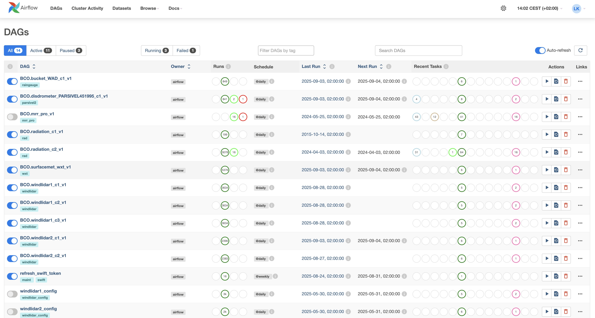

# Background

## The problem

::::{.columns}
:::{.column}
* Data needs to be **downloaded** to local computer
* Datasets often need to be **merged** before analysis
* This workflow does **not scale** for large datasets
:::

:::{.column}
](static/abernathy_cloud-native.png){height=500px .polaroid}
:::

::::

## The solution

* Creation of analysis-ready datasets
* Stored in publicly available object stores
* Using cloud-native data formats
* Appropriately chunked[^1] for analysis

[^1]: Don't worry; I will not talk about this today

## Object stores

* Store data as _objects_ (blob + metadata + unique key)
* Flat namespace (no real directories, just keys that look like paths)
* Accessed via web APIs (e.g., HTTP, S3), not via mounted drives
* Scales to billions of objects and petabytes of data
* Durable, redundant storage
* Global access via URLs, no special software needed

## <span style="color: #CE3072;">Cloud-native data formats</span>

* Designed for efficient reading/writing of chunks
* Metadata kept separate from data
* Support lazy, parallel access
* Work seamlessly with HTTP/S3 APIs

. . .

Zarr's chunked storage is aligned with object stores by construction

{height=52px}

## The promise

::::{.columns}
:::{.column}
* Analysis-ready datasets offer high performance
* Increase collaboration and reproducibility
* They are more fun, which fosters creativity
:::

:::{.column .fragment}

:::
::::

. . .

**Let's put this to the test with some real-life examples!**

# Scientific campaigns

> Plot all HALO flight tracks during the ORCESTRA campaign

## ORCESTRA campaign data

::::{.columns}
:::{.column}
* Data is spread across various repos<br>([HALO-DB](https://halo-db.pa.op.dlr.de), [PANGAEA](https://www.pangaea.de), ...)
* Access is often restricted by arbitrary embargos
* ... or by limited uptime of servers
* Dozens of files in various formats<br>([CSV](https://www.rfc-editor.org/rfc/rfc4180), [NASA Ames](https://airbornescience.nasa.gov/content/Ames_Format_Specification_v20), [NetCDF](https://www.unidata.ucar.edu/software/netcdf/), ...)
:::

:::{.column}
](static/halo-db.png)
:::
::::

## ORCESTRA Data Browser

::::{.columns}
:::{.column}
Acting as a **data broker** between providers and users

* **Manually** collected and [processed](http://github.com/orcestra-campaign/data2ipfs) data
* Made data **publicly available** via [IPFS](https://ipfs.tech)
* **List** and **search** all available datasets
:::

:::{.column}
](static/orcestra_data_browser.png)
:::

::::

## Plotting all HALO tracks {auto-animate=true}
```{python}
#| echo: true
import matplotlib.pyplot as plt
import xarray as xr

ds = xr.open_dataset("ipfs://bafybeif52irmuurpb27cujwpqhtbg5w6maw4d7zppg2lqgpew25gs5eczm", engine="zarr")

plt.plot(ds.IRS_LON, ds.IRS_LAT)
```

## Plotting a single HALO track {auto-animate=true}
```{python}
#| echo: true
#| code-line-numbers: "5"
import matplotlib.pyplot as plt
import xarray as xr

ds = xr.open_dataset("ipfs://bafybeif52irmuurpb27cujwpqhtbg5w6maw4d7zppg2lqgpew25gs5eczm", engine="zarr")
ds = ds.sel(TIME="2024-09-21")

plt.plot(ds.IRS_LON, ds.IRS_LAT)
```

# Continuous measurements

> Plot a time series of the temperature at the BCO


## <span style="color: #102952;">Barbados Cloud Observatory 🏝️</span>

::::{.columns}
:::{.column}

<span style="color: #ECC24C; text-shadow: 0 0 1px;">**"Half a climate" of atmospheric measurements!**</span>

:::{.fragment}
* Raw data is continuously copied to `breeze`
* Usually stored in plain text files
* You can read _any_[^2] file but not _all_
  ```{python3}
  xr.open_mfdataset("**/Meteorology__Deebles_Point__*.nc")
  ```
  :::{.fragment}
  _will simply fail due to the sheer number of files_
  :::
:::
:::

:::{.column}
](static/bco-website.png)
:::
::::

[^2]: Ask Rowan or Kirill about the "user experience"

## Automated processing

::::{.columns}
:::{.column width=50%}
Trying to solve the problem on the **provider** side

* Level 0 data is **automatically** processed each day
* Each instrument configuration is stored in a **single** Zarr store
* New data is **appended** to existing datasets
* Orchestration of tasks using an [Apache Airflow](https://airflow.apache.org)
* Data is **publicly available** on the [DKRZ Swift storage](https://docs.dkrz.de/doc/datastorage/swift/index.html)
:::

:::{.column}

:::
::::

## tcodata catalog

```{python}
#| echo: true
import intake


cat = intake.open_catalog("https://tcodata.mpimet.mpg.de/catalog.yaml")
wxt = cat.BCO.surfacemet_wxt_v1.to_dask()

wxt["T"].resample(time="6h").mean().plot(ylim=(23, 33), figsize=(12, 4));
```

# Climate models

> Plot a time series of the temperature at the BCO _from ICON output_

## Model output

::::{.columns}
:::{.column}
* Model output is usually stored in hundreds of datasets
* They may or may not align well (conflicting `height`/`height_2`)
* Users need to merge and/or concatenate before analysis:
  ```{sh}
  cdo -mergetime ngc5004_atm_2d_ml_P1D_*.nc ngc5004_atm_2d_merged.nc
  ```
  or
  ```{python3}
  xr.open_mfdataset("ngc5004_atm_2d_ml_P1D_*.nc")
  ```
  :::{.fragment}
  _which is not necessarily "interactive"..._
  :::

:::{.fragment}
The individual steps are not difficult, but they need to be performed by **each user** for **every run**.
:::
:::

:::{.column width=25%}
```{.raw}

```
:::
::::

## WCRP Global Hackathon

::::{.columns}
:::{.column}
* Comparing ~10 high-resolution climate models
* Scientists were located at 10-ish nodes across the globe
* Access to analysis-ready[^3] datasets stored at the producing centres
* Technical teams were **pre-processing for weeks**
* ICON data was written analysis-ready^1^ directly by `hiopy`
:::

:::{.column width=40%}
](static/global_Hackathon_Logo_V2.svg)
:::
::::

[^3]: At least we are getting there 😉

## The hackathon data catalog

```{python}
#| echo: true
#| output: true
import healpix as hp
import intake


cat = intake.open_catalog("https://digital-earths-global-hackathon.github.io/catalog/catalog.yaml")["online"]
icon = cat.icon_d3hp003(zoom=11, time="PT6H").to_dask()

# Find the grid cell that is closest to the BCO.
cell_bco = hp.ang2pix(icon.crs.healpix_nside, -59.4288, 13.1627, lonlat=True, nest=True)

icon.tas.sel(cell=cell_bco).plot()
```

# Quick looks

> Why a shortcut is sometimes the slower route

##

::::{.columns}
:::{.column}
Quick looks ...

* are often provided **instead** of data
* relieve the pressure of providing the actual data
* usually show **almost** what you are interested in
:::

:::{.column}
](static/smart-quicklook.png){height=600px}
:::
::::

## SMART time series HALO-20240821a {auto-animate=true}

```{python}
#| echo: true
#| output: false
import matplotlib.pyplot as plt
import xarray as xr


smart = xr.open_dataset("ipfs://bafybeia4winn7xzqchcss3ilgoyxj2rakdzrv3eswcbol5rsqgcku34zzu", engine="zarr")
smart = smart.sel(time="2024-08-21", wavelength=slice(400, 900))

bahamas = xr.open_dataset("ipfs://bafybeif52irmuurpb27cujwpqhtbg5w6maw4d7zppg2lqgpew25gs5eczm", engine="zarr")
bahamas = bahamas.sel(TIME="2024-08-21")

fig, axes = plt.subplots(figsize=(6, 6), nrows=3, sharex=True)
smart.SZA.plot(ax=axes[0])
bahamas.IRS_ALT.plot(ax=axes[1])
smart.Fup_meas.plot(x="time", vmin=0, vmax=2.2, cmap="coolwarm", ax=axes[2])
```

## SMART time series HALO-20240821a {auto-animate=true}

```{python}
#| echo: false
#| output: true
import matplotlib.pyplot as plt
import xarray as xr


smart = xr.open_dataset("ipfs://bafybeia4winn7xzqchcss3ilgoyxj2rakdzrv3eswcbol5rsqgcku34zzu", engine="zarr")
smart = smart.sel(time="2024-08-21", wavelength=slice(400, 900))

bahamas = xr.open_dataset("ipfs://bafybeif52irmuurpb27cujwpqhtbg5w6maw4d7zppg2lqgpew25gs5eczm", engine="zarr")
bahamas = bahamas.sel(TIME="2024-08-21")

fig, axes = plt.subplots(figsize=(6, 6), nrows=3, sharex=True)
smart.SZA.plot(ax=axes[0])
bahamas.IRS_ALT.plot(ax=axes[1])
smart.Fup_meas.plot(x="time", vmin=0, vmax=2.2, cmap="coolwarm", ax=axes[2])
```

##

::::{.columns}
:::{.column}
Quick looks ...

* are often provided **instead** of data
* relieve the pressure of providing the actual data
* usually show **almost** what you are interested in
<li class="fragment">are (often) created from a **different dataset**</li>
:::

:::{.column}
](static/smart-quicklook.png){height=600px}
:::
::::


# Summary

* Analysis-ready cloud-native repositories provide **scalable access** to large datasets
* Reduce duplication of data, support **collaboration**, and are **fun to use**
* Shift responsibility from the data users towards the data providers

. . .

**We need to ensure that our human resources scale!**<br>There is usually **one** data provider, but **many** users.


# The end...?

## The problem: Part 2

> Shift responsibility from the data users towards the data providers

* Data providers usually consider their job done once their data has been written to disk
* Asking for "analysis-ready datasets" means that data providers must **consider usability**
* We want to **avoid data brokers** since they are not experts on the data

. . .

**We need tools (e.g. hiopy, BCO processing chain) that can create analysis-ready datasets directly**
